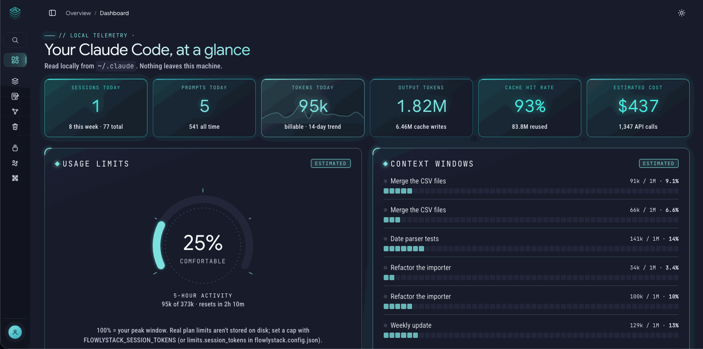
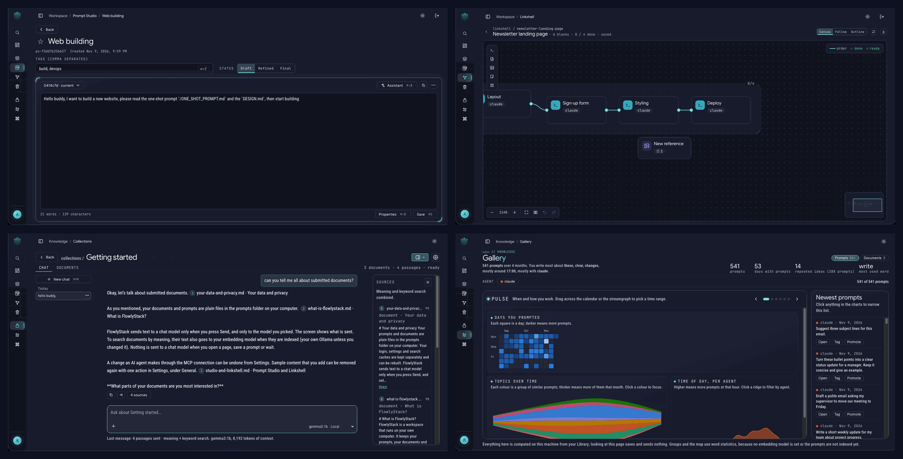

<h1 align="center">
  <picture>
    <source media="(prefers-color-scheme: dark)" srcset="docs/images/logo-dark.svg">
    
  </picture>
</h1>

<p align="center"><strong>Keep every prompt. Plan every build.</strong></p>

<p align="center">FlowlyStack is a private workspace on your own computer. It saves what you ask AI, shows how your ideas connect, and lets you plan a whole project as a canvas of prompts, so you always know what you asked, and what to ask next.</p>

<p align="center"><strong>Keep · Visualise · Plan</strong></p>

You've asked AI hundreds of questions, and the good ones are buried in old chats and forgotten text files. FlowlyStack catches your prompts as you work (once you switch capture on), keeps every version, and shows how they connect. And when you're ready to build, it lets you lay each prompt out on a canvas and follow it step by step. Everything stays on your own computer, as plain files you own: no cloud, no tracking.

Works with Claude Code, Codex and Open WebUI (Ollama).



Made for students, researchers, people who use AI every day without being programmers, and developers who live in the terminal.

## What you can do with it

- **See your AI usage.** The **Dashboard** shows your Claude Code, OpenAI Codex and Ollama activity: tokens, cost where the tool records it, busiest days and models. Limits are estimates and are labelled that way.
- **Keep every prompt you send.** The **Prompt Library** saves prompts from Claude Code, Codex and Open WebUI as files, with tags, notes, versions, search and a Trash with Undo.
- **Write prompts worth keeping.** **Prompt Studio** is a small shelf for the prompts you rely on: write, refine, compare versions, export. An optional **Assistant** chats with a model about the prompt on screen, only when you press Send.
- **Plan before you build.** **Linkshell** turns an idea into linked blocks (prompts, specs, references, phases). Follow the plan one prompt at a time and copy each prompt with its context.
- **Chat with your own documents.** **Collections** indexes your Markdown, text, PDF and JSON files, searches by meaning and keywords, and answers with numbered sources.
- **Spot patterns.** **Gallery** finds repeated prompts and groups. **Lattice** is a map of how your prompts, documents and projects connect.
- **Let an AI agent use it.** The built-in **MCP server** lets Claude Code, Cursor or the Claude desktop app search your library. Writing is off unless you allow it, agents can never delete anything, and every change can be undone.



## Install

You need [Docker](https://www.docker.com/products/docker-desktop/) (free). Pick one way:

| Your situation | Do this |
|---|---|
| **Mac or Linux, easiest** | `curl -fsSL https://raw.githubusercontent.com/cent822/flowlystack/main/install.sh \| bash` |
| **You use Claude Code or Codex** | Tell your agent: *Read https://raw.githubusercontent.com/cent822/flowlystack/main/skills/flowlystack-install/SKILL.md and follow it to install FlowlyStack.* |
| **Windows, or you like control** | Docker by hand: three short steps in the [Quick start](docs/quick-start.md#option-c-docker-by-hand-all-systems-including-windows) |
| **Developer** | `git clone https://github.com/cent822/flowlystack.git`, then `./run.sh` |

Every way ends at **http://127.0.0.1:8372**. The step-by-step version, with Docker explained, is the **[Quick start](docs/quick-start.md)**.

## Your first visit

1. Open **http://127.0.0.1:8372** and create your account. It is the one and only account, and it stays on your computer.
2. Press **Add samples** on the Dashboard to look around with example prompts, a project plan and a few documents. Remove them in one step whenever you like.
3. Optional: [connect Claude Code and Codex](docs/connect-agents.md) so the Dashboard shows your real usage and the Library fills itself.

## Privacy in three lines

- Your data lives in plain files in the `prompts` folder and a small database on your computer. No analytics, no telemetry, no external requests (even the fonts are bundled).
- Text goes to a model only when you press **Send** (and, to search your documents by meaning, to the embedding model you chose when they are indexed). It goes only to models you picked, and the app shows what is sent. Local models through Ollama keep everything on your machine. Details: [Privacy](docs/privacy.md).
- The app only reads the history folders of your AI tools, and nothing else in them. It never reads login or credential files.

## Documentation

**Start here**
- [Quick start](docs/quick-start.md)
- [Connect Claude Code and Codex](docs/connect-agents.md)
- [Updating and backup](docs/updating-and-backup.md)
- [Troubleshooting](docs/troubleshooting.md)

**Using FlowlyStack**
- [Dashboard](docs/dashboard.md) and [the usage-limits gauge](docs/usage-limits.md)
- [Prompt Library](docs/prompt-library.md)
- [Prompt Studio and the Assistant](docs/prompt-studio.md)
- [Linkshell](docs/linkshell.md)
- [Collections](docs/collections.md)
- [Gallery and Lattice](docs/gallery-and-lattice.md)
- [Settings and keyboard shortcuts](docs/settings-and-shortcuts.md)

**Connecting and sharing**
- [Connect an AI agent (MCP)](docs/mcp-setup.md)
- [Login, two-step login and reaching it from other devices](docs/remote-access.md)
- [Privacy: what the app contacts](docs/privacy.md)

What changed in each version is in [CHANGELOG.md](CHANGELOG.md). It is also shown inside the app under **What's new**.

## For developers

FlowlyStack is a FastAPI backend (Python 3.12) with a SQLite cache, plain JavaScript modules and D3 for charts. There is no build step and no framework. Meilisearch runs beside the app for typo-tolerant search and the app falls back to plain matching without it.

```bash
./run.sh                 # http://127.0.0.1:8372   (PORT=9000 ./run.sh to change)
```

- The design rules (colours, type, buttons) are in [DESIGN.md](DESIGN.md).
- Checks are plain-assert scripts in `scripts/`; the ones that call a server need a throwaway server with `FLOWLYSTACK_AUTH=off` and temporary prompts and settings folders.
- Contributions and bug reports are welcome; see CONTRIBUTING.md.

## Licence and credits

MIT licence, see LICENSE. The letters of the FlowlyStack logo are outlines of Inter Display SemiBold (SIL Open Font License 1.1, copy in `frontend/fonts/Inter-LICENSE.txt`; no Inter font file is shipped).

Bundled third-party pieces keep their own licences, with a copy next to each:

- Fonts in `frontend/fonts/` (Google Sans Flex, JetBrains Mono, Roboto Condensed): SIL Open Font License 1.1, with a `*-LICENSE.txt` copy for each.
- In `frontend/vendor/`: D3 (ISC, `d3.NOTICE.txt`), dagre (MIT, `dagre.NOTICE.txt`) and qrcode-generator (MIT, `qrcode.NOTICE.txt`).
