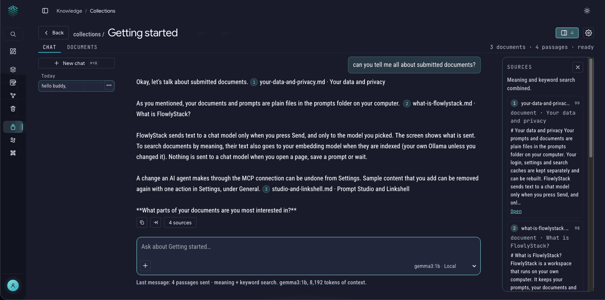
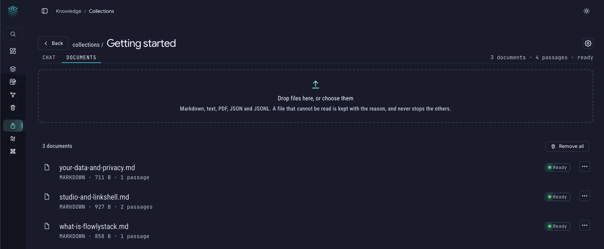

# Collections

**Collections let you chat with your own documents.** Drop in your notes, papers, manuals or exports, then ask questions in plain words. Each answer points to the exact passages it used, so you can check it.

Everything stays on your computer. Your documents are copied into the `prompts` folder and indexed on your machine. Text goes to a model in two cases only: to your **embedding model** when documents are indexed (your own Ollama by default), and to your **chat model** when you press Send. See [Privacy](privacy.md).



## What a collection is

A **collection** is a named group of documents, like a folder of reading for one subject: "Thesis papers", "Product docs", "Recipes". You can have as many as you like, give them tags and a short description, and star the ones you use most.

There is also one built-in collection, **My prompts**. It holds the prompts already in your [Library](prompt-library.md) and [Studio](prompt-studio.md), and it is always kept in sync. You can't delete it, and you can chat with your prompts like any other document.

A file can belong to **several collections** at once. It's one shared copy, so a change to the file shows up everywhere it is used.

## Set it up once

Chatting by meaning needs an **embedding model**: a small model that turns text into numbers so that similar meanings can be found. FlowlyStack uses your own **Ollama** for this, so nothing leaves your computer.

The Collections page shows a setup card that checks each step:

1. **Ollama is running.** Install and start [Ollama](https://ollama.com). In Docker, FlowlyStack reaches Ollama on your computer at `http://host.docker.internal:11434`, which is already the default.
2. **An embedding model is installed.** Run this in your own terminal. The app never downloads models for you:

   ```bash
   ollama pull embeddinggemma
   ```

3. **Choose it.** Pick the model in the drop-down on the card (or in **Settings > Knowledge**), then press **Check again** if needed.

You can **add documents before this is done**. They show "Waiting for a model" and are indexed on their own once you choose a model.

Without an embedding model, search still works, using keywords only, and the app says so.

## Add documents

Open a collection, go to the **Documents** tab and **drop files on the box** (or choose them). Supported: **Markdown, text, PDF, JSON and JSONL.**

- Files are **copied** into `prompts/collections/`. Your originals are untouched.
- A file the app can't read, such as a scanned or encrypted PDF, is kept with the reason shown, and **never stops the others**.
- Indexing shows its progress and can be **cancelled** and resumed.
- Each document has a **⋯** menu: **Rename**, **Re-index**, **Add to another collection** and **Remove from this collection**.
- **Remove all** takes every document out of the collection. Deletions go to the [Trash](prompt-library.md#trash-and-undo), with Undo.

Click a document to open it. It has three views: **Preview** (how it reads), **Indexed text** (exactly what was taken from the file, which helps when a PDF came out strangely) and **Edit** (change the text and save). Because a file may be shared, saving an edit asks you to confirm that it changes **every** collection that uses it.



## Chat with a collection

Open the **Chat** tab and type a question in plain words. Press Enter to send.

Under each answer a button such as **4 sources** opens the **Sources** panel (the same panel opens from the button at the top right). It lists the passages that were sent to the model as **numbered cards**. Each card shows the file name, the section, a **match score from 0 to 100**, the start of the passage and an **Open** link that takes you to the document. If the model refers to "[1]" or "[2]" in its answer, those numbers match the cards, so you can check every claim against your own text. Small models do not always add those numbers, and the Sources panel is there either way.

Under the box, the **+** button opens the search options:

- **Search before answering: Auto, On or Off.** *Auto* searches your documents when your question looks like it's about them. *On* always does. *Off* never does, so you are just chatting with the model.
- **Search in:** choose which collections to search. You can pick several. Keep at least one.

At the bottom right you choose the **chat model** and see a **Local** or **Remote** badge, so you always know where your text goes. The line under the box says exactly what was sent, for example: "Last message: 4 passages sent · meaning + keyword search. gemma3:1b, 8,192 tokens of context."

Search combines **meaning** and **keywords**, so it finds a passage by what it says and also by an exact word, name or number. Exact keyword matches always stay in.

### What gets sent, and when

- **Only when you press Send**, to the model you chose.
- The passages found are sent to the model **as part of your message**, never as hidden instructions. Text inside your documents is treated as information, never as a command to the model.
- Nothing is sent to the chat model when you open a page or wait. (Adding a file does send its text to your embedding model so it can be searched by meaning; switch **Index automatically** off in Settings to stop that.)

### Conversations

Each collection keeps its conversations (switch this off in Settings, and a conversation then lives only on the open page). You can rename, delete and **export** a conversation as Markdown or JSON, and copy any answer.

### Improving your prompts

If a reply contains a prompt you like, **Use as prompt** opens it as a new, **unsaved** draft in [Prompt Studio](prompt-studio.md). Nothing is saved until you press Save.

## Settings

**Settings > Knowledge** holds:

| Setting | What it does |
|---|---|
| **Embedding model** | Which model makes the searchable vectors. Changing it later means every document is indexed again, and nothing is rewritten until you confirm. |
| **Index automatically** | Index new and changed documents as soon as they arrive. When off, press **Index now** on the Collections page. |
| **Save conversations** | Keep each chat so you can come back to it. |
| **Passages per answer** | How many passages go to the model with each question. |
| **Relevance cutoff** | Only for *Auto*. 0 (the default) means the best matches are always sent. Closer to 1 is stricter. Exact keyword matches are always kept. |
| **Context size** | How much text the model may use at once (Ollama's `num_ctx`). Larger than the Assistant's, because passages need room. |
| **Your instructions** | The instructions the model gets for collection chats. Empty means a built-in text. |

If you don't want your prompts indexed, the **My prompts** collection has **Turn off auto-indexing**. You can turn it back on any time.

## Good to know

- **No Ollama and no Meilisearch?** Collections still work for browsing and keyword search. Chat needs a model: Ollama, or another service added in **Settings > Connections > Other runtimes**. Embeddings always use Ollama.
- **Rebuildable caches.** The vector index (`data/vectors`) and the keyword index can be deleted and rebuilt from your documents. Your documents and conversations in `prompts/collections/` are the real data, so back that folder up (see [Updating and backup](updating-and-backup.md)).
- **Agents can read it.** With [MCP](mcp-setup.md) switched on, an AI agent can list and search your collections. It can't change your documents.
