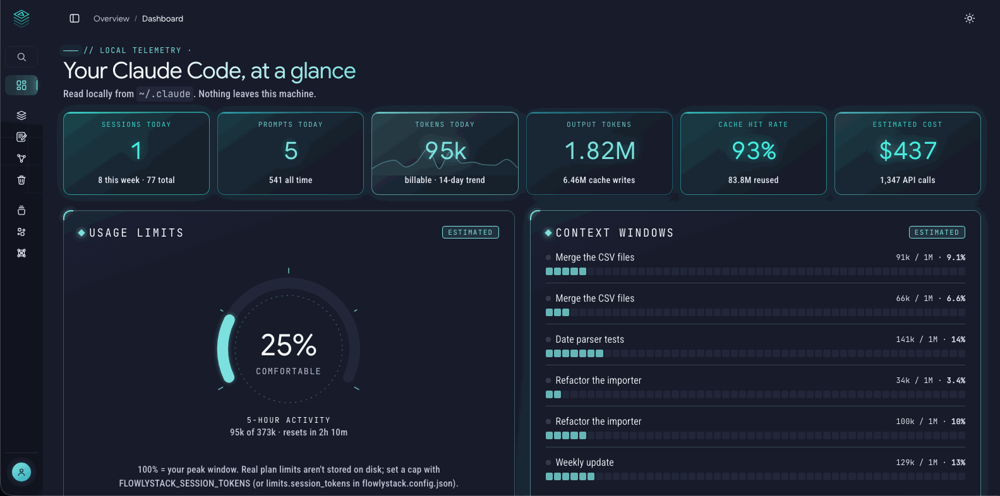
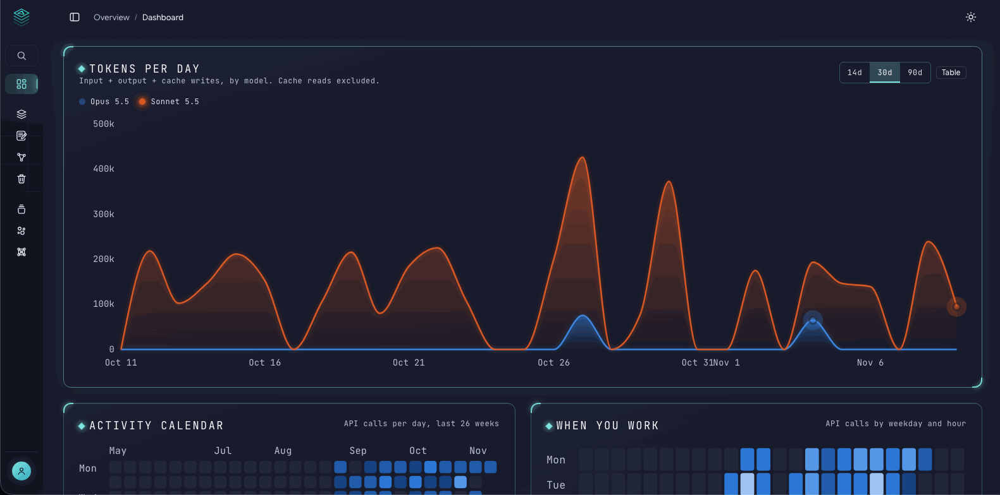
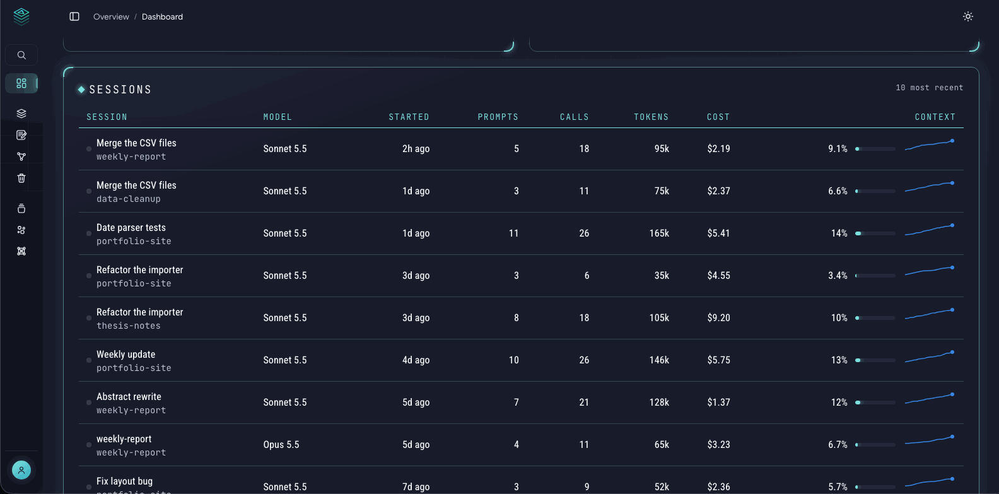

# Dashboard

The Dashboard shows how you use your AI coding tools: how much, when, on which projects, and how full each conversation is. It reads the history that the tools already keep on your computer, and draws charts from it. **Nothing leaves your machine.**

## What it shows

The Dashboard shows one tool at a time:

| Tool | What is read |
|---|---|
| **Claude Code** (terminal, and the Claude desktop app's Code tab) | The session history in `~/.claude` |
| **OpenAI Codex** | The session history in `~/.codex` |
| **Ollama** (through Open WebUI) | The chat database of Open WebUI: counts, dates, model names and chat titles, **never message text** |

Chats in the ordinary Claude desktop app and Cowork are **not** counted. To switch tools, use the drop-down at the top right (it appears when more than one tool is available). Your choice is remembered. The numbers of different tools are never added together.

The Prompt Library, Prompt Studio and Trash don't follow this choice. They have their own pages.

To connect your history folders, see [Connect Claude Code and Codex](connect-agents.md). Until they are connected, the Dashboard starts empty and tells you which folder it looked for.

## The cards

**The top row** answers "how busy have I been?":

- **Sessions today**, with this week and all-time totals.
- **Prompts today**, and all time.
- **Tokens today**: the billable tokens of today (input, output and cache writes), with a small 14-day trend line.
- **Output tokens**: what the model wrote, with the cache writes beside it.
- **Cache hit rate**: how much of the text sent was already remembered (cached), so it didn't have to be processed again. A high number is good: it means the tool is reusing earlier work.
- **Estimated cost** and the number of API calls.

**Below it:**

- **Usage limits**: a gauge for the current 5-hour window. It is an **estimate**, explained in [the usage-limits gauge](usage-limits.md).
- **Context windows**: for each recent session, how full its conversation is, as a bar and a percentage. A conversation that is close to full starts losing the oldest details, so this tells you when to start a fresh session. The size of the window is a **guess** from the model name, which is why it says "Estimated".
- **Tokens per day**: stacked by model, for 14, 30 or 90 days, with a **Table** switch if you prefer numbers. Cache reads are left out on purpose.
- **Activity calendar**: API calls per day for the last 26 weeks.
- **When you work**: calls by weekday and hour, so you can see your own rhythm.
- **Projects**: tokens used per project folder.
- **Tools Claude reaches for**: how often each tool (Bash, Read, Edit, a browser and so on) was called.
- **Sessions**: your ten most recent sessions with model, start time, prompts, calls, tokens, cost and context.

**The "running now" pill** at the top ("4 running · 1 busy") counts the sessions open at this moment. From source, it reads the list of running sessions. In Docker, the app can't see your computer's programs, so a session counts as running while its history changed in the last two minutes.

## Good to know

- **Cost** comes from what Claude Code itself records for a session. Some sessions record nothing, and then the card shows $0.00 or N/A. Treat it as a guide, not a bill. Codex records no cost at all, and Ollama runs on your computer, so those show **N/A** with the reason.
- **N/A is normal.** Where a tool has no data for a card, the card says N/A and why (for example, Codex has no running-session state).
- **Live updates.** The page refreshes by itself when a new message is written (about every five seconds), without reloading.
- **Dates and times** use your own time zone. In Docker this is the `TZ` line in `.env` (see [Quick start](quick-start.md)), so "today" is your today.
- **The history is a cache.** FlowlyStack summarises your tool's history into a small database (`data/`). You can delete it any time and it is rebuilt from the tool's files. Claude Code deletes old history after a while, so very old numbers can disappear from the source, but not from FlowlyStack's own copy until you delete it.
- **Theme.** The sun or moon button in the top bar switches day and night mode, and your choice is remembered.
