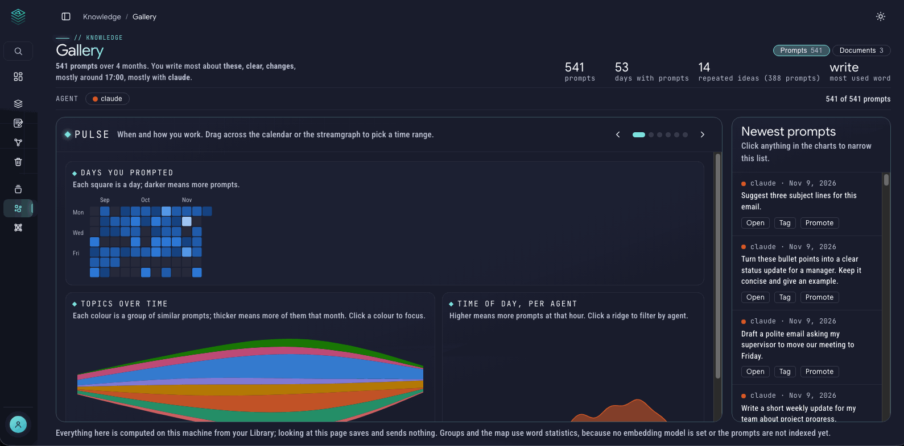
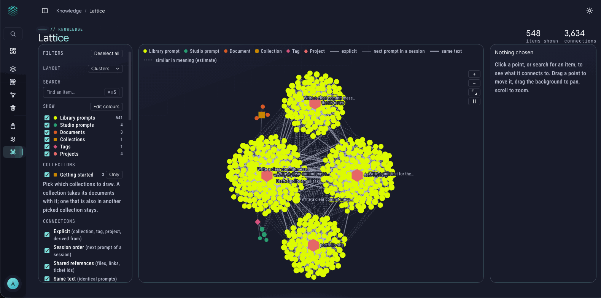

# Gallery and Lattice

These two pages are about **patterns**. After you have collected a few dozen prompts and documents, they show what is in there that you can't see one item at a time: which topics you return to, which prompts you keep rewriting, and how everything is connected.

Both are **read-only and private.** They are computed on your computer from your own files, no model is called, nothing is sent anywhere, and just looking at them saves nothing.

They need some material to work with. Neither page has much to show on a brand-new, empty install. See "How much do you need?" at the end.

---

## Gallery: patterns in your prompts

The **Gallery** turns your **Prompt Library** into charts. Open it from the sidebar (under **Knowledge**). A switch at the top changes between **Prompts** and **Documents** (the files in your Collections). The two are never mixed.

At the top, one sentence sums you up ("70 prompts over 3 months. You write most about …, mostly around 17:00, mostly with claude"), followed by four numbers: **prompts**, **days with prompts**, **repeated ideas** and your **most used word**.

Below that is a short slideshow. Use the arrow buttons or the **← and → keys** to move through six slides:

| Slide | What it shows |
|---|---|
| **Pulse** | **Days you prompted** (a calendar: each square is a day, darker means more prompts) and **Topics over time** (a streamgraph; each colour is a group of similar prompts). Drag across either to pick a time range. |
| **Vocabulary** | **Your words** (bigger means in more prompts), **Words that go together** (a line joins words that often share a prompt) and **Phrases you repeat** (an arc joins two words you keep writing side by side). |
| **Structure** | **Map of your prompts** (each dot is a prompt; close dots say similar things), **Topics and their words**, and **Which topics are close**. Drag a box on the map to select. |
| **Repeats** | **The same idea, written again**: each arc joins two similar prompts, and a long arc means you came back to it months later. Each group shows how many times you wrote it. |
| **Craft** | **Style of each prompt**: one line per prompt across six measurements (characters, lines, questions, variables, code blocks, hour of day). Drag on an axis to select, for example long prompts with code. Then **How the measurements relate**. |
| **Lifecycle** | **From capture to Studio** (how many prompts were never touched after capture, and where the others went), **Where prompts live** (by project and tool) and **Version history** of your Studio prompts. |

Every chart has a one-line caption, and the numbers on the axes are real values. Click a point, a word, a bar or a group, and the **Newest prompts** list at the bottom narrows to **the prompts behind it**. Each one has **Open**, **Tag** and **Promote**.

**Filters** work across slides: pick a tool, drag a time range, click a word or click a topic, and every slide narrows to match.

### Topics, repeats and the map

- **Topic groups** gather prompts that are about the same thing and name each group with its three strongest words.
- **Repeats** finds near-copies: prompts you wrote several times with small changes. It's a good hint that one of them deserves to become a saved Studio prompt.
- **The map** places every prompt on a flat page, close to its most similar neighbours.

The page tells you whether grouping is based on **meaning** or only on **words**. Without an embedding model it says, for example, "Grouped by words, not meaning, because no embedding model is set. Choose one in Settings > Knowledge." Everything still works, using words. Setting an embedding model (see [Collections](collections.md)) lets it group by meaning. The two kinds are never mixed in one picture.

### Acting on what you find

The Gallery mostly looks. Only two actions change anything, and both ask first:

- **Tag** the prompts you selected with a tag you choose.
- **Promote** a prompt into [Prompt Studio](prompt-studio.md) as a saved prompt. On the **Repeats** slide, each group of near-copies also has **Promote as template**, which saves that wording as one Studio prompt, so you stop rewriting it.

Both use the same routes as the Library and Studio pages, so they work the same way, with the same Undo.

### Words to ignore

Your own name or a project's codename can dominate the word charts. In **Settings > Knowledge**, **Gallery: words to ignore** takes a list (commas or spaces, capitals don't matter). The charts follow the next time you open the Gallery.

---

## Lattice: how it all connects

The **Lattice** is a **map of your knowledge**. Every prompt, Studio prompt, document, collection and tag is a dot, and a line joins two dots when they are related. Open it from the sidebar, under **Knowledge**.

### Reading the map

- **Dots:** *Studio prompt*, *Document*, *Collection* and *Tag* each have their own shape and colour, listed in the key above the map. Library prompts and Linkshell projects appear when you have them. You can change the colours with **Edit colours**.
- **Solid lines are facts.** Two things are joined because they really are: in the same collection, sharing a tag or project, one derived from another, the next prompt in the same session, identical text, or the same file, link or ticket number mentioned.
- **Dashed lines are guesses.** "Similar in meaning (estimate)" lines come from how close two texts are, and they are always labelled that way. Treat them as hints, not facts.

### Using it

- **Click a dot**, or search for an item with the search box, to see what it connects to. The side panel lists the same information as text, so everything on the map can also be read as a list.
- **Drag** a dot to move it, drag the background to pan, and scroll to zoom. The buttons give zoom, fit and pause for the motion.
- **Layout:** *Organic* is the live, floating layout. *Clusters*, *Fans*, *Tree* and *Concentric* arrange the same dots in tidy shapes.
- **Filters:** choose which kinds of dots to show (Studio prompts, Documents, Collections, Tags), which collections to draw, and which kinds of connection to include.
- **Similar lines:** set how many similar neighbours each dot gets and the minimum score, and hide dots with no connection.
- **Refresh** rebuilds the picture after you add things. It also rebuilds in the background by itself.

### Ask an agent about it (MCP)

A connected agent can read the Lattice: its overview, a search by title, what one item is connected to, the shortest chain between two items, and the entities with their quotes. The agent can also rebuild the base map, as the Refresh button does, and list the items no entity run has covered yet. Reading needs only a read-only token; see the [MCP guide](mcp-setup.md). Lines marked *similar* stay estimates when an agent reads them.

### Entities: people, tools and ideas (optional)

On top of the base map, you can add **entities**: the people, tools and concepts found inside your items, drawn as triangles linked to the items that mention them. Two optional ways to add them, and nothing happens until you start one:

- **With an AI agent (MCP).** Connect an agent with a write token ([MCP guide](mcp-setup.md)) and paste the ready-made prompt from the Lattice page. The agent shows you what it would add first. **Every link must come with a quote copied from the item**, and FlowlyStack checks that the quote is really there. Each run can be hidden or undone in one step.
- **With a local model.** A button reads your items with a model you pick, **only when you press Start**, after a dialog shows what will be sent. Ollama is the default. Smaller models give noisier entities; the quote check keeps them sourced, not necessarily right.

Agents can only add entities. They can never delete or change your own items.

---

## How much do you need?

- **Gallery (Prompts)** works best with a few dozen captured prompts. Until then it says "No prompts yet" and how to start. The sample content does **not** fill it on purpose, because it only holds prompts captured from your tools. Switch to **Documents** to see the sample documents.
- **Lattice** needs **at least 10 items** (prompts, Studio prompts and documents together) to draw a useful picture. Below that it lists what it has and tells you so. The sample content alone has fewer than 10 items.
- Both pages become more useful the longer you use FlowlyStack, especially once [prompt capture](connect-agents.md) is on.
