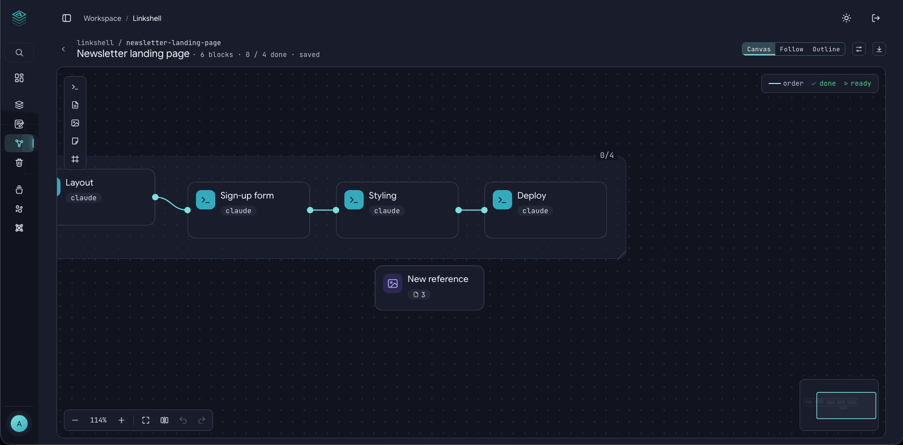
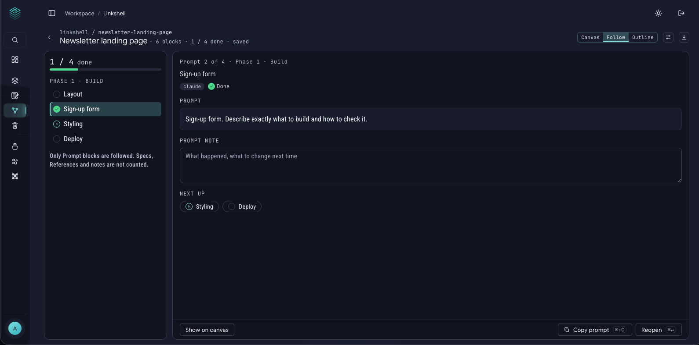

# Linkshell

**Linkshell is where you plan a project before you build it.** You put the idea on a canvas as linked blocks, one prompt for each piece of work, then follow the plan one prompt at a time with your AI tool.

Why bother? Throwing a big idea at an AI and letting it guess everything often costs re-work and wasted tokens. A short plan, with each step written clearly and the right background attached, usually gives better results with less back and forth. Linkshell turns that planning into something you can see, like a mind map.

It works for any project: a website, a thesis chapter, a study plan, an app, a research review. You don't need to write code.

## The idea in one minute

1. **Create a project** and write a **Brief**: what you want to make, in a few lines.
2. **Add Prompt blocks.** Each one is a piece of work to ask an AI to do.
3. **Link them** in the order to run them, and link in the Specs and References each one needs as background.
4. **Follow the plan.** Linkshell shows you one prompt at a time. Press **Copy prompt**, paste it into your AI tool, then **Mark done** and move on.

Want to try it first? Press **Add samples** on the Dashboard (see the [Quick start](quick-start.md)). It adds a ready-made project called "Plan a small website".

## Start a project

On the **Linkshell** page, press **New project**. Give it a name, and optionally a one-line description of what you are making. The canvas opens with a **Brief** block in it.

Projects are plain files in the `linkshell` folder inside your `prompts` folder. Deleted projects go to the [Trash](prompt-library.md#trash-and-undo) like prompts do.

## The blocks

| Block | What it is for |
|---|---|
| **Brief** | The start of the project: what you want, who it is for, any rules. It is not a prompt; you mark it done to start the plan. |
| **Prompt** | One piece of work to ask an AI to do. Write it like any prompt. Prompts are the steps you follow. |
| **Spec** | A written requirement or decision that a prompt should respect ("pages are plain HTML and CSS, no framework"). Link it into a Prompt and it comes along when you copy. |
| **Reference** | Files (images, documents) and web links that help, such as a screenshot of a design you like. Each file can carry a short note. |
| **Sticky note** | A note for yourself. It is never sent anywhere. |
| **Phase** | A labelled box that groups blocks into stages, such as "Phase 2: Pages". Removing a phase keeps its blocks. |

**On the canvas:** the small toolbar on the left adds a block: Prompt, Spec, Reference, Sticky note and Phase, in that order. Drag blocks where you like. **Double-click a title to rename it.** To write in a block, open its **⋯** menu and choose **Edit text and settings** (or select the block and press Enter); a panel slides in from the right with the text and a **Save** button (⌘S). The writing box fills the panel, so you can write while the canvas stays in view. For a long text, press the **expand** icon at the top right of the box: the text opens in a big window with lots of room. **Done** (⌘↵) puts it back in the panel, and you press **Save** there to keep it as a new version. Cancel or Esc leaves the text as it was. Along the bottom are zoom, fit to screen, **Tidy up canvas**, undo and redo, and a small map. **Tidy up canvas** arranges everything neatly, **Fit canvas to screen** zooms to show it all, and **Clear plan** removes every block and phase except the Brief.

You can also fill a Prompt block from your shelf: **From Studio** loads a [Studio](prompt-studio.md) prompt into the block, and **Save to Studio** keeps a good Prompt block as a Studio prompt. Every block keeps its own versions, so you can compare and go back.

## Links: order and background

Each block has a small dot on every side. **Drag from a dot to another block** to link them. A link means "this comes before that", and it does two jobs:

- **It sets the order.** A prompt is **Ready** when every Prompt (or the Brief) linked before it is done or skipped. Until then it shows what it is waiting for.
- **It carries background.** When a **Spec** or a **Reference** is linked to a Prompt, it is attached to that Prompt, and it is **added when you copy the prompt**. It doesn't matter which way you drag the link (the canvas draws no arrows): a Spec or Reference linked to a Prompt always comes along. The direction only matters between Prompts, where it sets the order. The AI gets the background without you pasting it by hand. The prompt's card shows how many ("2 ctx"). Specs and References are material that comes along, not steps to finish.

In the prompt's side panel, a **Context** list shows everything attached, with a switch for each one, so you can leave something out of a copy. To remove a link, select it and press Delete (an **Undo** appears for a few seconds).

## Follow the plan

Press **Follow**. Linkshell shows the prompts in order on the left and the one to work on in the middle.

- **Copy prompt** puts the prompt on your clipboard, together with the specs, references and notes that are linked to it. You paste it into your AI tool.
- **Mark done** when it worked, then you move to the next. **Skip** if you decide you don't need a step, and **Reopen** to bring one back.
- A prompt that is not ready yet says what it **waits for**. The Brief has its own **Mark Brief done** button, which starts the plan.
- Each prompt shows **Goes with it** (the background that comes along), a **Next up** list, and a **Prompt note** where you can write what happened and what to change next time.
- **Show on canvas** jumps back to the block in the canvas.
- A progress bar shows how many are done. When all are done, the plan is complete, and you can still open any prompt to look at it again.

A status dot shows each step: empty is To do, a play mark is Ready, a tick is Done and a dash is Skipped.

## Three views of the same plan

**Canvas**, **Follow** and **Outline** are three ways to look at one plan. Change something in one and the others show it. Outline is a plain list, good for reading the whole plan top to bottom or for using the keyboard.

## Copy, export and import

- **Copy** pastes the text exactly as written. There is no variable-fill step: a `{{name}}` stays plain text, and you replace it after pasting.
- **Export Markdown** gives you a "spec pack": a readable document you can put in your project's `docs/` folder so an AI tool has the whole plan to read. Each prompt comes with everything linked to it: its text in a block labelled `prompt`, each of its Specs in a block labelled `spec`, the files of its References (each with its note) in a block labelled `reference`, and the web links of its References in a block labelled `weblink`.
- **Export JSON** gives you a structured plan. An AI agent can read it (it is in the `plan` part), and FlowlyStack can rebuild the project from it. Reference files travel inside it.
- **Export to share (zip)** gives you one zip with `plan.md` and an `assets` folder that holds your reference files. The paths inside are relative, so the plan works wherever the zip is unzipped, for example in a repo's `docs/` folder or on a friend's computer, and nothing from your own computer shows. Use this when you want to hand the plan, screenshots included, to someone who doesn't use FlowlyStack. The plain Markdown export lists the files with their full paths on your computer, which is what you want for your own agent.
- Exports are always a **clean plan**: no progress, no step notes.
- **Import** on the project list turns a JSON export back into a **new** project. It never overwrites an existing one.

## Properties

**Project settings** holds the name, the default agent (the tool you usually give these prompts to) and **Properties**: your own name and value notes about the project. They go at the top of the Markdown export.

## Agents can read your plans

With [MCP](mcp-setup.md) switched on, an AI agent can list your projects, read a plan and assemble the exact text for a step. If you allow writing for its token, it can also **create a new project from a plan**. It can never change or delete one of yours. Anything it creates is tagged `via-mcp` and can be undone in Settings.

## Good to know

- **Saving is automatic and safe.** If two browser tabs edit the same project, an out-of-date save is refused instead of overwriting, and you are asked to reload.
- **Nothing is sent anywhere.** Linkshell doesn't call a model. It prepares the text; you paste it.
- **Search and the command palette** (⌘K) find projects and blocks.
- **Shortcuts** for Linkshell are listed, and can be changed, under **Settings > Keyboard**.
