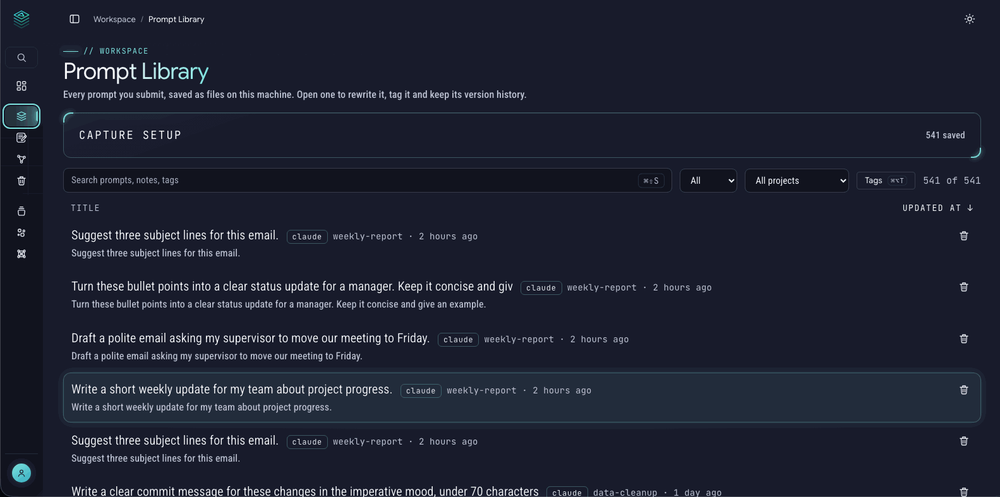

# Prompt Library

The Prompt Library is your **history**: a copy of every prompt you have sent to your AI tools, saved automatically as a plain file on your computer. You can search it, tag it, add notes, rewrite a prompt and keep every version.

Think of it as a notebook that fills itself while you work. If you want a small shelf of prompts you write on purpose and rely on, that is [Prompt Studio](prompt-studio.md).

## Getting prompts in

The Library holds prompts only from your AI tools, never made-up ones. There are three ways they arrive:

| From | How |
|---|---|
| **Claude Code** (terminal and the desktop app's Code tab) | A small hook saves each prompt the moment you send it. You switch it on once. |
| **Codex** | The same kind of hook, plus an **Import** button and a **Live sync** switch. |
| **Open WebUI** (your Ollama chats) | The **Import** button and the **Live sync** switch. |

The setup for all three is on the Library page under **Capture setup**, and is explained step by step in [Connect Claude Code and Codex](connect-agents.md). Every prompt carries a label (`claude`, `codex` or `ollama`). Once more than one tool has prompts, a **Source** filter appears.

> **Why capture early?** Claude Code deletes old session history after a while. A prompt that is in your Library is yours to keep, even when the original is gone.

## Finding a prompt

- **Search** at the top. Type a few words and the list narrows as you type. With the search service running, which is the case in the Docker install, it forgives typos ("deploymnt" still finds "deployment") and highlights what matched. Without it, search matches plain pieces of text, and everything still works.
- **Filters:** by tag, by project and by source. You can combine tags: a prompt must carry all of the chosen tags.
- **Sort and pages:** by last change, title and other columns; while you search, the best match comes first until you pick a column. Long lists are split into pages.
- **Keyboard:** the arrow keys move through the list, and Enter opens a prompt. **Esc** leaves the search box. ⌘K (Ctrl+K on Windows and Linux) opens the command palette, which can jump to any page.

## Opening a prompt

Click a prompt to open it. On the page you can:

- **Rewrite it.** Edit the text and press **Save** (⌘S). Every save becomes a **version** that you can compare, restore or delete. The original, exactly as you sent it, is never changed.
- **Describe what changed.** Each save asks for a short note, which makes old versions easy to recognise.
- **Compare versions** side by side and **restore** an old one. Restoring makes a new version; nothing is lost.
- **Tag it, star it and add a note.** Tags are free words you choose. A note is a place for "when did this work well?".
- **Copy it.** The Copy button puts the text on your clipboard, exactly as written.
- **Save as reusable prompt.** Open the **⋯** menu and choose this to copy the prompt into [Prompt Studio](prompt-studio.md). The Studio copy keeps a link back, and the Library original stays untouched.

## Trash and Undo

When you delete a prompt, it goes to the **Trash** page in the sidebar. A message with **Undo** appears right away. In the Trash you can restore a prompt or delete it for good. The Trash empties itself after 30 days; you can change that, or turn it off, in the settings file (`trash.days`, 0 turns it off).

A prompt you trash or delete is **not imported again** from Codex or Open WebUI, so cleaning up stays clean.

## Where the files are

Everything is in the `prompts` folder inside your `flowlystack` folder (running from source: the `prompts` folder of the project). Each prompt is a few small files next to each other:

| File | What it holds |
|---|---|
| `<id>.json` | The prompt exactly as you sent it. Never edited. |
| `<id>.meta.json` | Title, tags, note, star |
| `<id>.md` | The current text, if you rewrote it |
| `<id>.versions.json` | The saved versions |

You can open, copy and back up these files with any tool. There is no database for prompt text, and no cloud copy. Back up the `prompts` folder and you have backed up the Library. More in [Updating and backup](updating-and-backup.md).

## Good to know

- **Nothing is sent anywhere.** The Library only saves, organises and shows. No model is called.
- **Gallery and Lattice** read the Library to find repeated prompts and connections. See [Gallery and Lattice](gallery-and-lattice.md).
- **Agents can read it, not change it.** With [MCP](mcp-setup.md) switched on, an AI agent can search and read the Library. It can never edit or delete a Library prompt.
