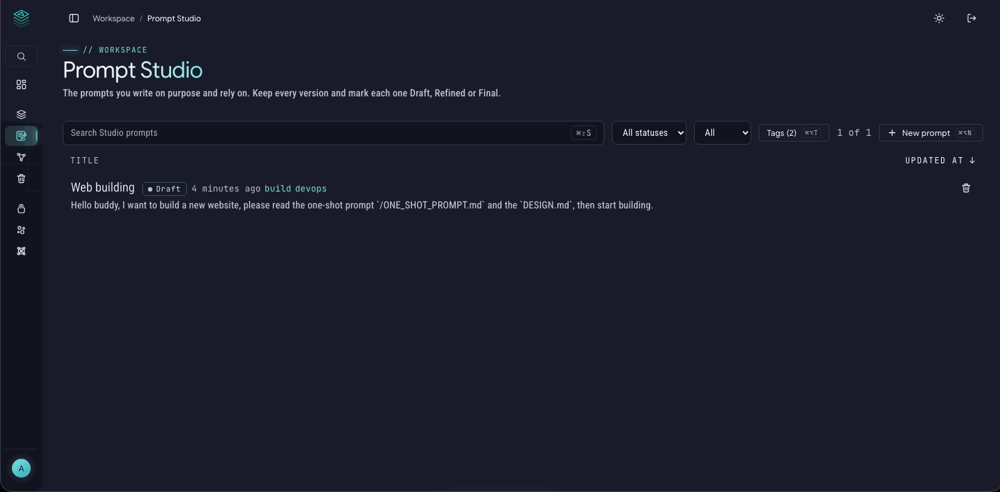
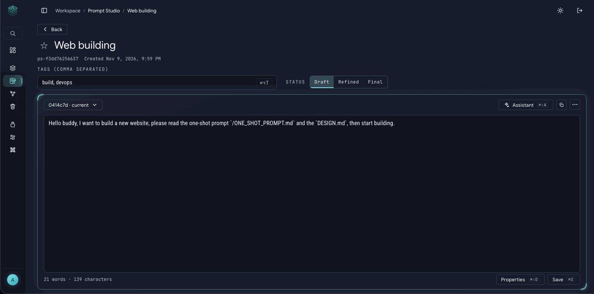
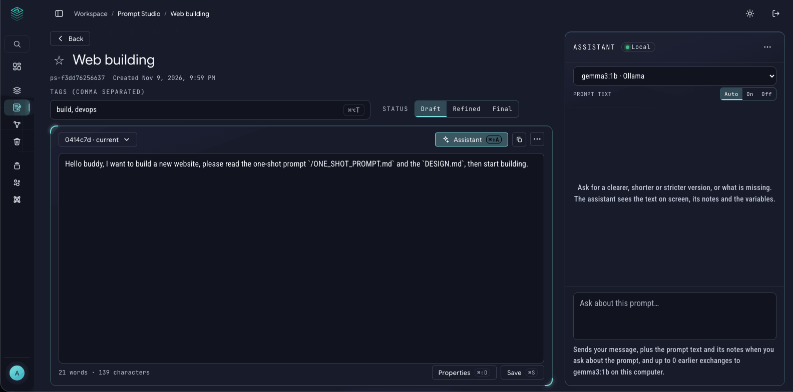

# Prompt Studio and the Assistant

**Prompt Studio** is a small shelf for the prompts you write on purpose and rely on: the one that reviews your code, the one that summarises a paper, the one that drafts your weekly email. Write it, refine it, keep every version, and copy it when you need it.

The [Prompt Library](prompt-library.md) is your history of everything you sent. Studio is your shelf of the few that matter. They are kept apart, so Studio prompts never show up in the Library list.

## Write a prompt

1. Press **New prompt** (or ⌘K and type "New prompt"; ⌘⌥N on a Mac, Ctrl+Alt+N elsewhere).
2. Write the prompt. **Nothing is saved until your first Save**, so you can start and walk away.
3. Press **Save** (⌘S). It asks you to describe what changed, for example "first draft" or "shorter, added an example".

Every save is a **version**. You can compare any version with the current text, restore an old one (it becomes a new version, nothing is lost), or delete an old version. The current version can't be deleted.

## Status, tags and notes

- **Status:** mark each prompt **Draft**, **Refined** or **Final**. It's a quick way to see which prompts you trust.
- **Tags and star:** tags are free words you choose, and a star keeps your favourites at hand.
- **Properties** (⌘⇧D): your own notes about the prompt as name and value pairs, such as `purpose`, `use_when`, `target` (which tool or model it is for) and `example`. You can add any name you like. Every property is written into the header of a Markdown export.

## Variables: how `{{name}}` works

You can write `{{name}}` in a prompt to mark something that changes each time, like `Summarise {{topic}} for a {{audience}}`. FlowlyStack **does not fill these in**. A `{{name}}` is plain text, and **Copy** gives you the prompt exactly as written, with the braces. You replace them after you paste. This keeps Studio simple and sends nothing anywhere.

## From the Library to Studio

Found a good prompt in your Library? Open it, choose **⋯** and then **Save as reusable prompt**. Studio gets its own copy, with a link back to the original. The Library original is never changed.

## Export and Trash

- **Export** a prompt as Markdown (the text plus a header with status, tags and your properties) or as JSON. The export is what is on the screen, even if you haven't saved yet.
- Deleted Studio prompts go to the same **Trash** as the Library, marked `studio`, with the same Undo and the same 30-day rule.

## The Assistant: chat with a model about your prompt

On a Studio prompt page, **Assistant** (⌘⇧A) opens a side panel. You chat with a model about the prompt on the screen: ask it to tighten the wording, find unclear parts, or make it more specific.

**Set it up once.** The Assistant needs a model. It uses your own **Ollama** by default, so nothing leaves your computer. Install and start Ollama, then pick the model in **Settings > Connections** and **Settings > Assistant**. In Docker, FlowlyStack reaches Ollama on your computer at `http://host.docker.internal:11434`, which is already the default. You can also add LM Studio, llama.cpp, vLLM, Jan, LocalAI, or any service that speaks the OpenAI style of API (a server you run, Hugging Face, OpenAI and others) under **Settings > Connections > Other runtimes**. A key you type there is stored only in `data/secrets.json` and is never shown again, exported or put into a chat.

The panel shows a **Local** or **Remote** badge, so you always see whether the model runs on your computer.

### What gets sent, and when

- **Only when you press Send**, and only to the model you picked. Nothing is sent when you open the panel, save, or leave it open.
- **The prompt text: Auto, On or Off.** *Auto* sends the text of the prompt only when your message is about it ("rewrite", "polish", "improve"), so you can also just chat about anything else. *On* always sends it. *Off* never does. The panel shows what goes with each message.
- **Your instructions.** In Settings you can write your own instructions for the Assistant. If you leave it empty, a built-in default is used.

### Taking an answer

The Assistant **never writes to your prompt by itself.** Choose **Use as prompt** under a reply (or on the part you selected) to load it into the editor as an **unsaved draft**. You read it, change it if you like, and press Save, or leave it.

Each question and answer is saved with the prompt as a pair, and you can export them as Markdown or JSON. You can switch this off in Settings.

## Search

With the search service running (always the case in the Docker install), Studio has its own search index next to the Library's, with typo tolerance and highlights. Without it, search falls back to plain matching.

## Where the files are

Studio prompts are plain files in the `studio` folder inside your `prompts` folder, grouped by month. Back up the `prompts` folder and you have backed up Studio too. See [Updating and backup](updating-and-backup.md).
