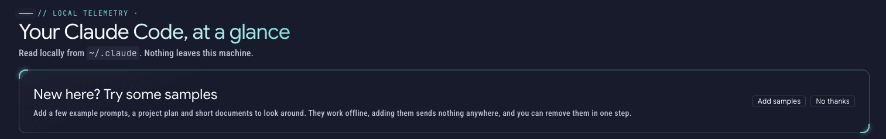
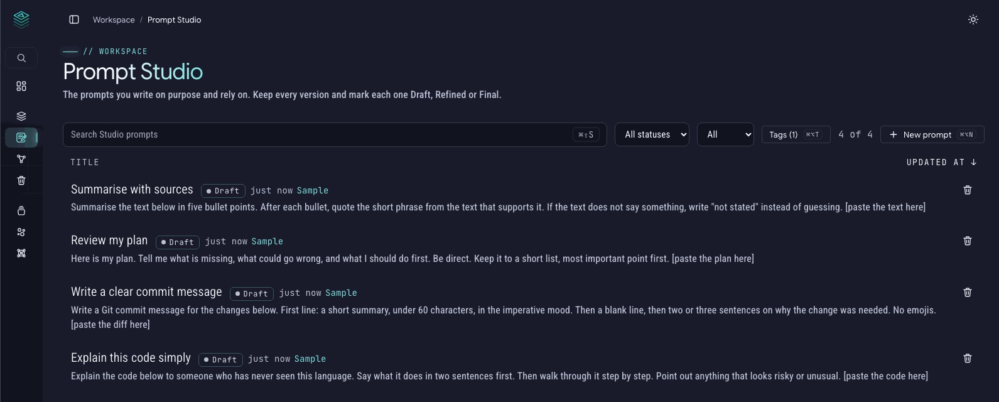

# Quick start

This page gets FlowlyStack running on your own computer in about five minutes. You do not need to be a programmer.

**What you get:** a private app that runs on your computer, keeps your prompts and documents as plain files you own, and shows how much you use AI tools such as Claude Code and Codex. Your text goes to a model only when you press Send in a chat, or when you index documents for search, and only to a model you chose (your own Ollama by default). More in [Privacy](privacy.md).

## Before you start

FlowlyStack runs inside **Docker**, a free program that runs apps in a small sealed box so they do not mess up your computer. You need Docker once:

- **Mac or Windows:** install [Docker Desktop](https://www.docker.com/products/docker-desktop/) and open it. Wait until it says it is running. (On Windows it needs the "WSL 2" option, which the Docker installer offers.)
- **Linux:** install [Docker Engine](https://docs.docker.com/engine/install/) with the "compose plugin".

To check, open a terminal (on Mac: the app **Terminal**; on Windows: **PowerShell**) and type:

```bash
docker compose version
```

If it prints a version number, you are ready.

## Step 1: Install

Pick **one** of these. All of them end in the same place.

### Option A: The installer script (Mac and Linux, the easiest)

```bash
curl -fsSL https://raw.githubusercontent.com/cent822/flowlystack/main/install.sh | bash
```

The script makes a folder called `flowlystack` in your home folder, starts the app, and prints the address to open. It asks no questions, never uses `sudo`, never deletes anything, and is safe to run again. If you would like to read it before running it, download it and read it first:

```bash
curl -fsSL -o install.sh https://raw.githubusercontent.com/cent822/flowlystack/main/install.sh
bash install.sh --help
```

It also looks for the folders where Claude Code and Codex keep their history (it only checks that they exist, never what is inside), so your Dashboard can show your real usage.

### Option B: Ask your AI agent to do it

If you already use Claude Code or Codex, paste this into it:

> Read https://raw.githubusercontent.com/cent822/flowlystack/main/skills/flowlystack-install/SKILL.md and follow it to install FlowlyStack.

The agent checks your system, explains what it will do and asks before it runs anything. It will not choose your password or touch your accounts.

### Option C: Docker by hand (all systems, including Windows)

Make a folder and download the compose file into it.

**Mac or Linux:**

```bash
mkdir -p ~/flowlystack/prompts ~/flowlystack/empty
cd ~/flowlystack
curl -fsSL https://raw.githubusercontent.com/cent822/flowlystack/main/docker-compose.yml | grep -v '^    build: \.$' > docker-compose.yml
docker compose up -d
```

**Windows (PowerShell):**

```powershell
$dir = Join-Path $HOME 'flowlystack'
New-Item -ItemType Directory -Force (Join-Path $dir 'prompts'), (Join-Path $dir 'empty') | Out-Null
cd $dir
(Invoke-WebRequest -UseBasicParsing https://raw.githubusercontent.com/cent822/flowlystack/main/docker-compose.yml).Content -split "`r?`n" | Where-Object { $_ -ne '    build: .' } | Set-Content docker-compose.yml
docker compose up -d
```

The first start downloads the app, which takes a minute or two.

### Option D: From the source code (for developers)

You need Git and [uv](https://docs.astral.sh/uv/).

```bash
git clone https://github.com/cent822/flowlystack.git
cd flowlystack
./run.sh
```

`run.sh` sets up a Python environment the first time and starts the app on the same address as below. Use `PORT=9000 ./run.sh` to change the port.

## Step 2: Open it and create your account

Open this address in your browser **on the same computer**:

**http://127.0.0.1:8372**

The first time, you see **Create your account**. Choose a username and a password (at least 8 characters). This is the one and only account; there is no email and no sign-up for anyone else. After that, every visit asks you to log in, even on your own computer.

> **Good to know:** create the account on the computer that runs FlowlyStack, at `127.0.0.1`. A sign-up that arrives from another device or through a web proxy is refused on purpose, so nobody can claim a server you just put online. If your port 8372 is already taken, see [Troubleshooting](troubleshooting.md).

## Step 3: Look around with the samples

A new app is empty. On the first page (the **Dashboard**) you will see a card, **New here? Try some samples**. Press **Add samples** to get:

- 4 example prompts in **Prompt Studio**
- 1 example project plan in **Linkshell**
- 1 small **Collection** with 3 short documents

They work offline, adding them sends nothing anywhere, and they are all tagged **Sample**. (If you index the documents for search, their text goes to your embedding model, like any document; see [Privacy](privacy.md).) When you are done, go to **Settings > General > Sample content > Remove sample content**. They move to the Trash, so you can still get them back. If you press **No thanks**, you can add them later from the same place in Settings.




## Step 4: Connect your real tools (optional)

The Dashboard shows your own Claude Code and Codex usage when it can read their history folders, and the Prompt Library fills up when you switch on prompt capture. Both are optional and explained in [Connect Claude Code and Codex](connect-agents.md).

Want an AI agent to search your prompts for you? See [Connect an AI agent (MCP)](mcp-setup.md).

## Everyday commands

Run these inside your `flowlystack` folder (Option D: just use `./run.sh`).

| What you want | Command |
|---|---|
| Update to the newest version | `docker compose pull` then `docker compose up -d` |
| Stop the app | `docker compose down` |
| Start it again | `docker compose up -d` |

Your prompts and documents are plain files in the `prompts` folder inside `flowlystack`. Your login, settings and caches live in a Docker volume. Stopping or updating the app keeps both. More in [Updating and backup](updating-and-backup.md).

## Where next

- [Connect Claude Code and Codex](connect-agents.md)
- [Troubleshooting](troubleshooting.md)
- [Reach FlowlyStack from another device](remote-access.md) (login, two-step login, web proxies)
- [Connect an AI agent (MCP)](mcp-setup.md)
