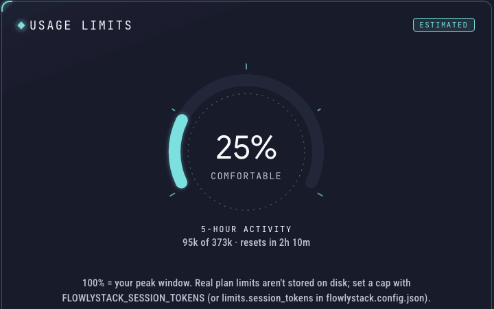

# The usage-limits gauge

The **Usage limits** gauge on the [Dashboard](dashboard.md) answers one question: *how busy is this 5-hour period compared with my own busiest one?*

**It is not your plan's real limit.** Claude Code does not write your plan limits to your computer, so FlowlyStack can't read them. The gauge is an estimate, and the card says "Estimated" to keep that honest.



## How it works

1. FlowlyStack groups your activity into **5-hour windows**. A window opens at your first message after the previous window closed, and lasts five hours.
2. For the current window, it adds up your **billable tokens**: input, output and cache writes. **Cache reads are left out**, because they are cheap and would swamp the number.
3. It compares that total with your **busiest window so far**. That busiest window counts as 100%.

So a gauge at 40% means: "this window has used 40% of what my busiest ever window used". Under the gauge you see the real numbers, for example "43k of 1.92M", and when the window resets.

## What the words mean

| Gauge | Label |
|---|---|
| Below 75% | **Comfortable** |
| 75% and above | **Running high** |
| 90% and above | **Near your peak** (or **Near the limit** if you set your own limit) |

If you have just started using the tool, your busiest window is small, so the gauge can jump high quickly. It becomes more meaningful as your history grows.

## Use a real limit instead

If you know your plan's cap, you can tell FlowlyStack. Then 100% means that number, and the label says "Near the limit".

- **Docker:** add a line to your `.env` file (next to `docker-compose.yml`), then run `docker compose up -d`:

  ```
  FLOWLYSTACK_SESSION_TOKENS=1500000
  ```

- **From source:** set the same variable (`FLOWLYSTACK_SESSION_TOKENS=1500000 ./run.sh`), or create `flowlystack.config.json` in the project folder, next to `run.sh`:

  ```json
  { "limits": { "session_tokens": 1500000 } }
  ```

The variable wins if both are set. Use a plain number of tokens; the gauge compares it with the billable tokens of the current 5-hour window.

## Why there is no weekly gauge

A weekly gauge was built and removed on purpose: it sat at 100% almost all the time and told you nothing. A gauge that always says "full" is not useful.

## Codex is different

OpenAI Codex records what its own plan reports, so for Codex the gauge shows the real percentage used and when it resets, as of the newest session that recorded it. There, 100% is your plan's limit.
